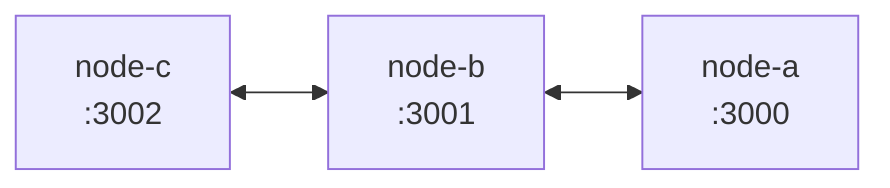
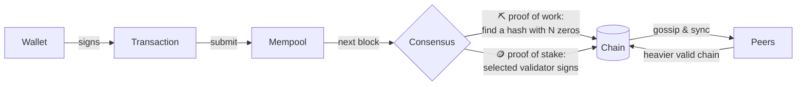
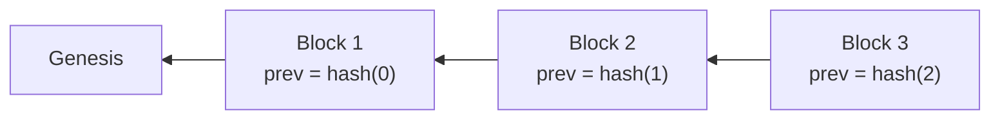
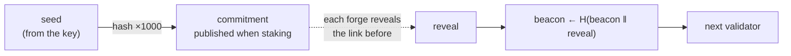
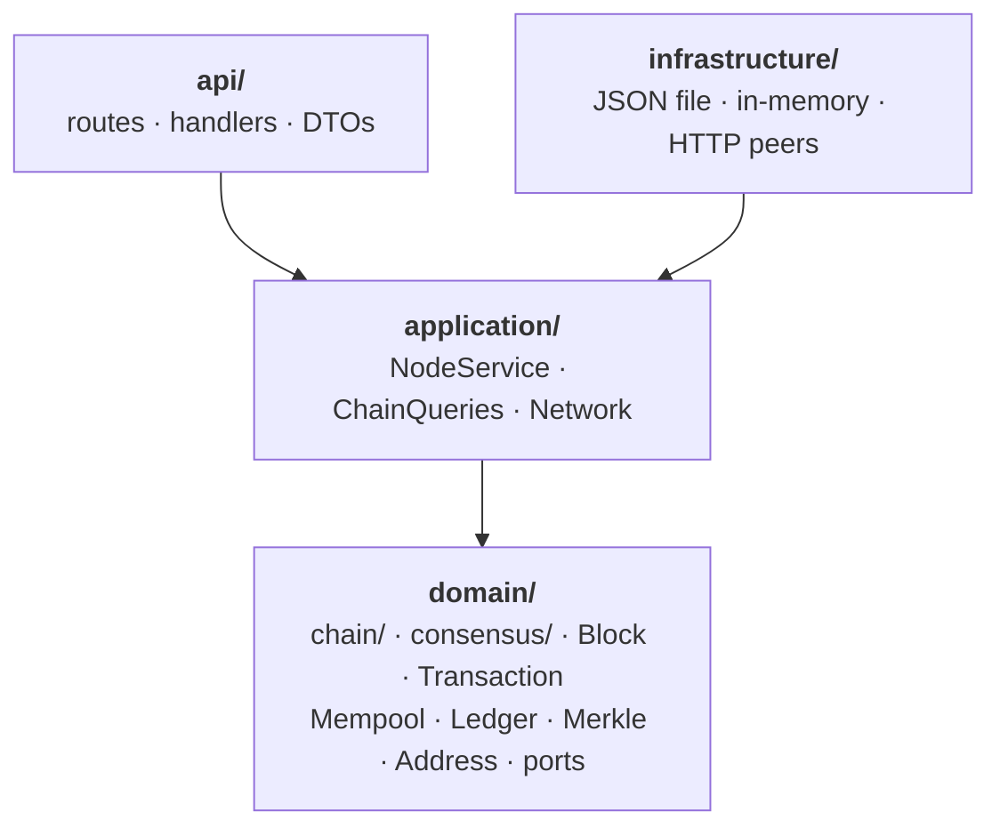

<div align="center">

# ⛓️ blockchain-rs

**A small, readable cryptocurrency in Rust that you can run, break and watch heal.**

Proof of work *or* proof of stake · keys that never leave your browser · fees · peers that gossip and sync · a web UI that explains every block

[](https://github.com/alex-quiterio/blockchain-rs/actions/workflows/test.yml)


</div>

---

## ✨ What's inside

| | |
| --- | --- |
| 🔐 **Wallets** | ed25519 keypairs made and used in your browser. Keys never leave the page, and they're saved encrypted with your passphrase. |
| ✍️ **Transactions** | Signed over `from \| to \| amount \| nonce` (plus the fee, when there is one). The nonce stops replays. |
| ⛏️ **Proof of work** | Mine a block by finding a hash below a target. The difficulty adjusts every few blocks to keep them coming at a steady pace as miners join or leave. |
| 🪙 **Proof of stake** | Lock coins with a transaction to `stake`. Each block's validator is drawn at random, weighted by stake, from a commit-reveal randomness beacon that forgers can't steer, then signs the block. |
| 💸 **Fees** | Optional per transaction. Whoever adds the block gets the reward plus every fee in it. A block holds at most `MAX_BLOCK_TRANSFERS` transfers, so when more are waiting the highest fees go in first and the rest wait for the next block. |
| 🌐 **Peers & sync** | Nodes introduce themselves both ways and gossip each new block on its own to every peer at once, sending the last few blocks only to a peer that lacks them. Every few seconds they compare tips and pull only what they're missing, 500 blocks at a time, which is how a node far behind catches up. A node that hears from a peer it doesn't know adds it back, so links heal after a restart. |
| 🏆 **Heaviest chain wins** | Forks are settled by total work (proof of work) or total stake behind the blocks (proof of stake), not length. Ties go to the lower tip hash so every node agrees, and no fork may undo more than `MAX_REORG_DEPTH` blocks. Transfers that dropped out go back to the mempool. |
| 💾 **Storage** | The chain is saved as JSON, one block per line. A new block is appended, so saving costs the same however long the chain gets; only a fork rewrites the file, atomically. Every `SNAPSHOT_BLOCKS` blocks a snapshot of the balances is saved beside it, so a restart replays only the blocks since; the blocks before it must hash and link up to the snapshot's block, so changed ones are refused. `GET /chain/valid` still replays everything. |
| 🌳 **Merkle roots** | A block's hash covers the Merkle root of its transactions, not the transactions themselves. A light client keeps only headers and checks that a payment is in a block from a proof of a few hashes. |
| 🔍 **Validation** | Replays everything: links, hashes, Merkle roots, work or signatures, rewards, fees, nonces, balances and stakes. A refusal names the block and the rule it broke, such as `block 2: transaction 1: signature does not match sender`. |

## 🚀 Quick start

```sh
docker compose up --build     # three linked nodes on :3000, :3001 and :3002
# or, for a single node:
cargo run                     # http://127.0.0.1:3000
```

Open **http://127.0.0.1:3000** and:

1. 🔒 **Choose a passphrase.** It encrypts your wallets' keys before they're saved in the browser.
2. 👛 **Make a couple of wallets**, then **mine** a block to fund one.
3. 💸 **Send some coins**, with a fee if you like. The page signs the transaction itself and only the signature goes to the node.
4. 🔍 **Open any block's Breakdown** to see why it's valid. With Docker running, open `:3001` too and watch the block arrive.
5. 🧭 **Open the Explorer** (`/explorer.html`) to debug any block, transaction or address. Search by height, hash, signature or address. Each page redoes the node's checks in your browser: header hashes, proof of work, signatures, Merkle proofs and payouts.

### Proof of stake

```sh
CONSENSUS=pos CHAIN_FILE=pos.json cargo run
```

While nothing is staked, anyone may forge. Forge a few blocks to earn coins, send some to **Stake** from the Send panel, and watch the Forge panel switch to whoever's turn it is.

### 🐳 A three-node network, one command

```sh
docker compose up --build
```



That starts nodes on **:3000**, **:3001** and **:3002**. C and A only know B, and gossip carries everything across. Mine on one node and the block reaches the others within seconds. Add `CONSENSUS=pos` in front for proof of stake, and `GIT_COMMIT=$(git rev-parse --short HEAD)` to show the real commit in the footer. Each node keeps its chain in its own volume, and `docker compose down -v` wipes them.

<details>
<summary><b>Without Docker</b></summary>

```sh
cargo build
BIND_ADDR=127.0.0.1:3000 CHAIN_FILE=a.json ./target/debug/blockchain &
BIND_ADDR=127.0.0.1:3001 CHAIN_FILE=b.json PEERS=http://127.0.0.1:3000 ./target/debug/blockchain &
BIND_ADDR=127.0.0.1:3002 CHAIN_FILE=c.json PEERS=http://127.0.0.1:3001 ./target/debug/blockchain &
```

</details>

Each node's UI shows its peers and whether they're ahead, behind or in step.

### 🌊 Put it under pressure

The load generator floods a network with random signed transactions, with random fees, and adds blocks on a schedule like a pool of miners. It prints what happens every second.

```sh
docker compose --profile load run --rm loadgen        # against the Docker network
# or against nodes you started yourself:
NODES=http://127.0.0.1:3000,http://127.0.0.1:3001 cargo run --release --bin loadgen
```

```
  25s  sent 751 (30.0/s)  ok 594  rejected 157  confirmed 565  latency p50 2.4s p95 6.0s  fees/block 66.2  |  a h20 mp29 · b h20 mp29 · c h20 mp17  ✓ in sync
──── Summary ────
  Sent            1201 in 44s (27.3/s)
  Accepted        888 (73.9%)
  Rejected        157 (nonce out of order)
  Rejected        156 (not enough funds)
  Confirmed       888 (0 still waiting)
  Latency         p50 3.4s  p95 10.5s  max 14.5s
  Blocks          16 (55.5 tx and 64.2 in fees each)
```

Each wallet sends through one "home" node, as a real user would, so the others only hear about its transactions by gossip. You can watch mempools fill and drain, nodes fall behind and catch up, and forks settle. The rejections are honest load effects: wallets spending faster than their coins confirm, and nonces racing ahead of a rejected transaction. Tune it with `RATE`, `SECS`, `WALLETS`, `BLOCK_EVERY` and `MAX_FEE`.

The first run of it found a real bottleneck: every new transaction re-checked the whole mempool, so nodes stalled for 20 seconds under load. The mempool now keeps a running projection and checks each transaction once.

<details>
<summary><b>📸 Proof of work, light mode</b></summary>
<br />

</details>

## ⚙️ Configuration

| Variable | Default | What it does |
| --- | --- | --- |
| `CONSENSUS` | `pow` | `pow` or `pos`. |
| `DIFFICULTY` | `4` | Proof of work's starting difficulty, in leading hex zeros: 16⁴ = 65,536 hashes a block. |
| `TARGET_BLOCK_SECS` | `10` | The pace the difficulty aims for. `0` keeps it fixed. |
| `RETARGET_BLOCKS` | `10` | Blocks between difficulty adjustments. |
| `REWARD` | `50` | Coins paid for each block, before fees. |
| `BIND_ADDR` | `127.0.0.1:3000` | Where the node listens. |
| `CHAIN_FILE` | `chain.json` | Where the chain is saved. |
| `PEERS` | none | Comma-separated peer URLs to join on startup. |
| `PUBLIC_URL` | `http://$BIND_ADDR` | How peers should reach this node. |
| `SYNC_SECS` | `5` | How often to pull from peers. |
| `MAX_REORG_DEPTH` | `64` | The most of its own blocks a node will undo to switch forks. A fork is checked from where it splits off, not from genesis. |
| `MAX_BLOCK_TRANSFERS` | `100` | The most transfers a block may hold, besides its payout. When more are waiting, the highest fees go first. `0` sets no limit. |
| `SNAPSHOT_BLOCKS` | `100` | Blocks between snapshots of the balances, which spare a restart replaying the whole chain. `0` takes none. |

A saved chain only loads under the rules it was made with. Delete the file to start over.

## 🧠 How it works



Every block stores the hash of the one before it, so changing an old block breaks every block after it:



When forks compete, a node keeps the **heaviest** valid chain, not the longest:

| Consensus | One block weighs | Why |
| --- | --- | --- |
| ⛏️ Proof of work | the work it required | The hashes it takes on average to find at its difficulty, so the fork with the most work wins. |
| 🪙 Proof of stake | its validator's stake (at least 1) | A short fork forged by real stakers outweighs a long one nobody staked on. |

Exact ties go to the lower tip hash, so two nodes on equal forks always pick the same one. And no fork may undo more than `MAX_REORG_DEPTH` blocks, however heavy it is, so old history can't be rewritten.

The first transaction in each block is the **payout**: the reward plus the block's fees, to whoever mined or forged it. Validation checks that sum.

### 💸 Fees decide what gets in

A block holds at most `MAX_BLOCK_TRANSFERS` transfers, and every node refuses one with more; a block submitted with too many is told so (`TooManyTransfers`). That cap is the only consensus rule; which transfers fill a block is the producer's choice. A node's mempool offers them by fee, highest first, with two limits on the order:

- **A sender's transfers keep their nonce order.** A sender is ranked by the fee of their *next* transfer, so a big fee stuck behind a small one waits for it.
- **A payment goes in before what spends it.** A transfer paid for with coins that are still on their way waits until the payment that brings them is chosen.

Among equal fees, whichever arrived first goes first. What's left stays in the mempool for the next block. While everything fits, a block takes it all in the order it arrived.

### ⏱️ Difficulty that follows the miners

Proof of work counts difficulty as **work**: how many hashes a block takes to find on average. A block is accepted when its hash, read as a number, is at most `MAX / work`. For a work of 16ᵈ that's exactly "starts with d zeros", but any value in between works too, so the difficulty can move in small steps.

Every `RETARGET_BLOCKS` blocks, the node compares how long the last ones took with how long they should have taken, and scales the work by the difference, by at most 4× either way:

```
new work = old work × (target time ÷ time they took)        e.g. 10 blocks in 50s, aiming for 100s → 2× the work
```

The pace comes from timestamps, which the miner chooses, so two Bitcoin rules keep them honest. A block must be later than the median of the 11 before it, so it can't be backdated to fake a slow pace. And it can be at most 2 hours ahead of the node's clock. Chains mined before the difficulty could adjust still load: their blocks meet the same targets. Each block's breakdown in the UI shows the work it needed and, where the difficulty changed, why.

### 🎲 Validator turns nobody can steer

Under proof of stake, the next validator is drawn from a **randomness beacon**, not from the previous block's hash. Seeding the draw from the hash would hand the forger a lever: they could try timestamp after timestamp until the draw picked them again. The beacon works like Ethereum's RANDAO:

1. **Commit.** A validator's first stake publishes the end of a secret hash chain, `H¹⁰⁰⁰(seed)`. The seed is derived from their key, so their wallet can recompute any link and nobody else can.
2. **Reveal.** Every block they forge must reveal the next link back: a value whose hash is the last one shown. Anyone can check it with one hash, and it was fixed the moment they committed.
3. **Mix.** The reveal is mixed into the beacon, `R ← H(R ‖ reveal)`, and the beacon picks the next validator.



A forger's block can differ in timestamp and contents, but its reveal can't, so none of those differences change who's next. While nothing is staked, anyone may forge and the beacon doesn't move at all. Unstaking everything ends a commitment, and a validator who uses up all 1,000 reveals sits out until they stake again with a new one.

## 🏛️ Architecture

The code follows domain-driven design. Dependencies only point inward:



- **`domain/`** has the rules and no I/O.
  - `chain/`: the chain itself.
    - `mod.rs`: the `Blockchain` aggregate root, which every change goes through: mining, forging, `extend` and `adopt_if_heavier`
    - `events.rs`: `ChainEvent`, what each change did: `Started`, `Extended` or `Reorganized`. The node saves only what they say is new, then tells its listeners, which log it
    - `validation.rs`: the rules each block is checked by, and replaying a chain by them
    - `tally.rs`: what the blocks add up to, the `TallyLog` of the last few tallies that forks are checked from, and `Snapshot`
  - `consensus/`: how the network agrees on one chain.
    - `rules.rs`: `ChainRules`, `Consensus` and the stake-weighted `select_validator`
    - `difficulty.rs`: proof-of-work targets as work, retargeting, and the timestamp rules
    - `weight.rs`: `ChainWeight`, what a fork is worth: 16^difficulty per mined block, or the validator's stake per forged block
    - `randao.rs`: the commit-reveal hash chains and the beacon that pick validators
  - `block.rs`: `Block`, which mines, forges and hashes itself, and `Transaction`, which signs itself. Only the domain can change either; outside it they can only be read, and doctests check it stays that way
  - `merkle.rs`: Merkle roots and proofs over a block's transactions
  - `mempool/`: the `Mempool`, an aggregate of its own: transactions waiting to be mined, kept as a running projection. It rebases onto the chain's ledger whenever the chain changes, taking back what a fork dropped; producing a block asks it for `candidates`, and the chain keeps those that still apply, in the order given, as many as a block holds.
    - `selection.rs`: what it offers when more is waiting than a block holds: the highest fees first, keeping each sender's nonce order. A producer's choice, not a consensus rule It says what happened with `MempoolEvent`s: `Accepted` for each transfer submitted, `Rebased` for how a chain change left it
  - `ledger.rs`: balances, stakes, nonces and validators, keyed by `Address`
  - `values/`: value objects, each checked when it's made, so the rest of the domain never handles a malformed one or mixes one kind up with another. They travel as the plain string or number they wrap.
    - `address.rs`: an `Address` can only hold a valid public key
    - `hash.rs`: `BlockHash`, `MerkleRoot`, and for proof of stake `Commitment`, `Reveal` and `Beacon`: each can only hold 64 hex characters, and none can be passed for another
    - `signature.rs`: `Signature`, 128 hex characters; a block reward has none, which travels as `""`
    - `capacity.rs`: `BlockCapacity`, how many transfers a block may hold: at most some number, or any
    - `coins.rs`: `Coins`, every amount, fee, stake, balance and reward, whose sums are checked so they never wrap around
    - `party.rs`: where a transaction's coins come from (`Source`: an account, or new coins for a block reward) and go (`Destination`: an account, or into or out of a stake), instead of strings with magic values
  - `error.rs`: why something was refused, by what it was: `ValueError`, `TransactionError`, `BlockError` or `ChainError`, each operation failing only in the ways of what it handles, and `DomainError` where they meet. Validation says which rule a block breaks (`BrokenLink`, `MerkleRootMismatch`, `InsufficientWork`, `WrongPayout`, `BadTransfer`…), and a refused chain says at which height
  - `crypto.rs`, `repository.rs`: signing and hashing, and the storage port, which is told the events to save
- **`application/`**
  - `NodeService` runs each use case that changes the chain on a copy of it, swaps it in only once it's saved, rebases the mempool from the events, then tells its listeners what happened to both. The network listens: every transfer the mempool accepts is gossiped to every peer but the one it came from, however it arrived. The chain and the mempool have separate locks, so submitting a transaction never waits for mining or a peer's blocks.
  - `ChainQueries` answers every question about the chain (blocks, headers, accounts, history, proofs) and changes nothing.
  - `Network` keeps the peers in step through the `PeerClient` port.
- **`infrastructure/`** has the adapters: `JsonFileRepository`, `InMemoryRepository` and `HttpPeerClient`.
- **`api/`** is the HTTP interface. **`public/`** is the web UI, plain HTML, CSS and JS with no build step.
- **`src/bin/loadgen.rs`** is the load generator, a separate client that only talks to nodes over HTTP.

## 📡 API

| Method | Path | What it does |
| --- | --- | --- |
| POST | `/wallets` | Make a keypair: `{address, secret_key}`. |
| GET | `/balances/:address` | `{balance, staked, next_nonce, next_epoch, reveals_left, commitment_due}`. The last three tell a wallet which commitment or reveal to send. |
| POST | `/transactions/sign` | `{secret_key, to, amount, fee?, nonce?, commitment?}` → a signed transaction. `to` may be `stake` or `unstake`. A first stake's commitment is worked out from the key if left out. |
| POST | `/transactions` | Submit a signed transaction. It's gossiped to peers. |
| GET | `/transactions/pending` | The mempool. |
| GET | `/transactions/:signature/proof` | A Merkle proof that a confirmed transfer is in its block: `{transaction, leaf, proof, header, confirmations}`. Hash `leaf\|` + the transaction's JSON, combine it with each step's hash on the step's `side` as `node\|left\|right`, and you reach `header.merkle_root`. `404` while it's unconfirmed. |
| GET | `/headers` | Every block without its transactions, or with `?from=N` from height N on: what a light client keeps. |
| GET | `/blocks/:id` | A block, by height or hash. |
| GET | `/transactions/:signature` | `{transaction, status, block}`: whether it's `confirmed` or `pending`, and if confirmed its block's height, hash, position and confirmations. |
| GET | `/addresses/:address/transactions` | Every transaction to or from an address, block rewards included: pending first, then newest first. |
| POST | `/mine` | Proof of work: `{miner}`. |
| POST | `/forge/proposal` | Proof of stake: `{validator, reveal?}` → the unsigned block that validator should sign next. The reveal is required once validators are being drawn. |
| POST | `/blocks` | Proof of stake: submit a proposal signed by its validator. |
| POST | `/forge` | Proof of stake shortcut for scripts: `{secret_key}` of the selected validator. |
| GET | `/consensus` | Rules (including `max_block_transfers`), the next block's work and the next adjustment, stakes, the randomness beacon and whose turn it is next. |
| GET | `/chain` | Every block, or with `?from=N` the blocks from height N on, and with `&limit=M` at most M of them. |
| GET | `/chain/work` | Proof of work: the work each block required, by height. Takes `?from=N&limit=M` like `/chain`. |
| GET | `/status` | `{height, tip, weight, pending}`, cheap enough to poll every second. |
| POST | `/chain` | Offer blocks, the whole chain or just the newest: adopted if they make a valid, heavier chain. `{replaced, length, missing_parent}`, where `missing_parent` asks for blocks from further back. `409` if it would undo too many blocks. |
| GET | `/chain/valid` | `{valid, problem, length, weight}` after a full replay. `problem` names the first block that breaks a rule and how, or is `null`. |
| GET · POST | `/peers` | List peers, or add one with `{url}`. |
| POST | `/sync` | Pull from every peer now. |
| GET | `/node` | Version and git commit of the running node. |

> 🔐 **How the UI protects keys.**
> - **On disk:** secret keys are encrypted with your passphrase (PBKDF2-SHA256, 600,000 rounds, then AES-256-GCM) before they're saved, so browser storage only ever holds scrambled data.
> - **In use:** unlocking decrypts them into the tab's memory, and Lock, closing the tab or 15 idle minutes wipes them.
> - **Backup:** **Back up** exports the encrypted vault and **Restore** imports one; there's no passphrase reset.
> - **Limits:** this runs only on `localhost`, `127.0.0.1` or HTTPS, where browsers allow WebCrypto. A malicious extension running while you're unlocked could still read the page's memory.
>
> The web UI never sends a secret key. It generates keys and signs transactions in the page, and forges by asking for a proposal, signing its hash and sending back the signed block. `/wallets`, `/transactions/sign` and `/forge` still take keys over HTTP as shortcuts for `curl` experiments; don't use them for anything real.

## 🧪 Tests

```sh
cargo test        # 147 tests: unit, HTTP, property-based and doctests
```

- **Domain:** consensus rules, staking, fees, picking a full block's transfers by fee, forks and tampering.
- **Application:** a whole peer network simulated in one process.
- **HTTP:** round trips through the API, including forging with a key that never leaves the client.
- **Properties** (`tests/properties.rs`, [proptest](https://proptest-rs.github.io/proptest/)): hundreds of random scenarios per run.
  - Random transfers, stakes and blocks never create or destroy coins, and never break nonces or replay.
  - Transactions arriving in any order end in the same balances.
  - Forks offered in any order settle on the same chain.
  - No version of a block, whatever its timestamp, contents or fees, changes who forges next.
  - Whatever the pace of blocks, the difficulty changes only at adjustment heights, by at most 4×, and the chain's weight is exactly the work its blocks required. This one caught a rounding bug that let an adjustment exceed 4×.
  - Tampered forks are never adopted.

  Failing cases shrink to a minimal example and are saved to `tests/properties.proptest-regressions`. Run more with `PROPTEST_CASES=1000 cargo test --release --test properties`.

CI runs `fmt`, `clippy -D warnings` and the tests on every push and pull request.

## 💡 Ideas

Nothing here is built yet. Each would make a good next step.

**⚖️ Consensus**
- **Slashing**: burn the stake of a validator caught signing two blocks at the same height.
- **Finality checkpoints**: stakers vote to make a block permanent, instead of relying only on the reorg limit.
- **Skipping absent validators**: a selected validator who never forges stalls the chain. Time slots that pass the turn on after a timeout would fix it, and withholding a reveal would then cost a block reward.

**💸 Fees and blocks**
- **Fee estimates**: suggest a fee from what recent blocks accepted.

**🔐 Wallets and privacy**
- **HD wallets**: many addresses from one seed phrase.
- **Multisig addresses** that need M of N signatures to spend.

**🌳 Light clients**
- **Headers-first sync**: fetch and check headers before full blocks.

**🌐 Network**
- **Peer discovery**: learn new peers from existing ones.
- **Ban misbehaving peers** that keep offering invalid chains.

**🛠️ Developer experience**
- **Load generator scenarios**: partition a node mid-run, or add miners part way, to watch forks and retargeting react.
