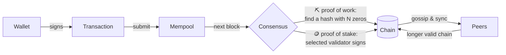
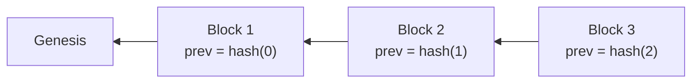
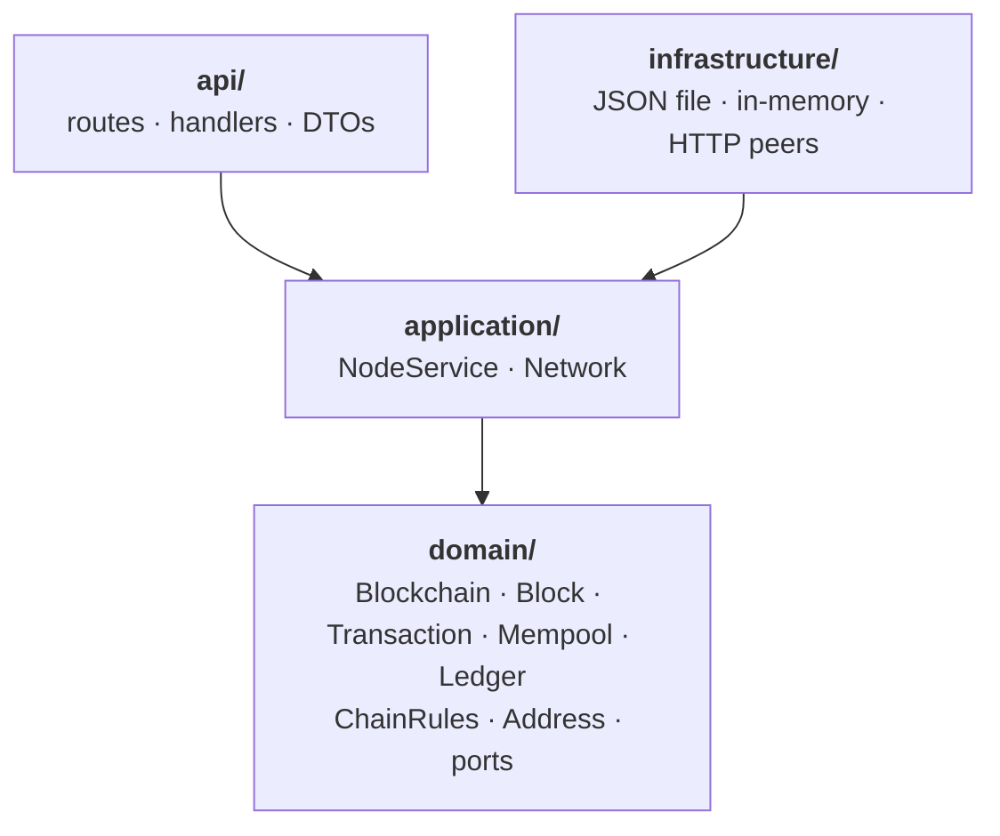

<div align="center">

# ⛓️ blockchain-rs

**A small, readable cryptocurrency in Rust that you can run, break and watch heal.**

Proof of work *or* proof of stake · signed transfers with optional fees · peers that gossip and sync · a web UI that explains every block

[](https://github.com/alex-quiterio/blockchain-rs/actions/workflows/test.yml)


</div>

---

## ✨ What's inside

| | |
| --- | --- |
| 🔐 **Wallets** | ed25519 keypairs. An address is the hex public key. |
| ✍️ **Transactions** | Signed over `from \| to \| amount \| nonce` (plus the fee, when there is one). The nonce stops replays. |
| ⛏️ **Proof of work** | Mine a block by finding a hash with `DIFFICULTY` leading zeros. |
| 🪙 **Proof of stake** | Lock coins with a transaction to `stake`. Each block's validator is drawn at random, weighted by stake and seeded by the previous hash, then signs the block. |
| 💸 **Fees** | Optional per transaction. Whoever adds the block gets the reward plus every fee in it. |
| 🌐 **Peers & sync** | Nodes introduce themselves both ways, gossip new blocks and transactions, and pull from each other every few seconds. |
| 🏆 **Longest chain wins** | A valid, longer chain replaces yours. Transfers that dropped out go back to the mempool. |
| 💾 **Storage** | The chain is saved to JSON with atomic writes and fully replayed on startup, so a tampered file is refused. |
| 🔍 **Validation** | Replays everything: links, hashes, work or signatures, rewards, fees, nonces, balances and stakes. |

## 🚀 Quick start

```sh
cargo run          # http://127.0.0.1:3000
```

Open **http://127.0.0.1:3000**, create a couple of wallets, mine a block, send some coins, and open any block's **Breakdown** to see why it's valid.

### Proof of stake

```sh
CONSENSUS=pos CHAIN_FILE=pos.json cargo run
```

While nothing is staked, anyone may forge. Forge a few blocks to earn coins, send some to **Stake** from the Send panel, and watch the Forge panel switch to whoever's turn it is.

### A three-node network on one laptop

```sh
cargo build
BIND_ADDR=127.0.0.1:3000 CHAIN_FILE=a.json ./target/debug/blockchain &
BIND_ADDR=127.0.0.1:3001 CHAIN_FILE=b.json PEERS=http://127.0.0.1:3000 ./target/debug/blockchain &
BIND_ADDR=127.0.0.1:3002 CHAIN_FILE=c.json PEERS=http://127.0.0.1:3001 ./target/debug/blockchain &
```

Mine on `:3002` and the block shows up on `:3000`, two hops away, within seconds. Each node's UI shows its peers and whether they're ahead, behind or in step.

<details>
<summary><b>📸 Proof of work, light mode</b></summary>
<br />

</details>

## ⚙️ Configuration

| Variable | Default | What it does |
| --- | --- | --- |
| `CONSENSUS` | `pow` | `pow` or `pos`. |
| `DIFFICULTY` | `4` | Leading hex zeros a proof-of-work hash needs. |
| `REWARD` | `50` | Coins paid for each block, before fees. |
| `BIND_ADDR` | `127.0.0.1:3000` | Where the node listens. |
| `CHAIN_FILE` | `chain.json` | Where the chain is saved. |
| `PEERS` | none | Comma-separated peer URLs to join on startup. |
| `PUBLIC_URL` | `http://$BIND_ADDR` | How peers should reach this node. |
| `SYNC_SECS` | `5` | How often to pull from peers. |

A saved chain only loads under the rules it was made with. Delete the file to start over.

## 🧠 How it works



Every block stores the hash of the one before it, so changing an old block breaks every block after it:



The first transaction in each block is the **payout**: the reward plus the block's fees, to whoever mined or forged it. Validation checks that sum.

## 🏛️ Architecture

The code follows domain-driven design. Dependencies only point inward:



- **`domain/`** has the rules and no I/O.
  - `chain.rs`: the `Blockchain` aggregate root, which mines, forges, validates and runs `adopt_if_longer`
  - `block.rs`: `Block`, which mines, forges and hashes itself, and `Transaction`, which signs itself
  - `rules.rs`: `ChainRules`, `Consensus` and the stake-weighted `select_validator`
  - `mempool.rs`, `ledger.rs`: pending transactions, and the balances, stakes and nonces
  - `address.rs`: a value object that can only hold a valid public key
  - `error.rs`, `crypto.rs`, `repository.rs`: domain errors, signing and hashing, and the storage port
- **`application/`**
  - `NodeService` runs each use case on a copy of the chain and only swaps it in once it's saved.
  - `Network` keeps the peers in step through the `PeerClient` port.
- **`infrastructure/`** has the adapters: `JsonFileRepository`, `InMemoryRepository` and `HttpPeerClient`.
- **`api/`** is the HTTP interface. **`public/`** is the web UI, plain HTML, CSS and JS with no build step.

## 📡 API

| Method | Path | What it does |
| --- | --- | --- |
| POST | `/wallets` | Make a keypair: `{address, secret_key}`. |
| GET | `/balances/:address` | `{balance, staked, next_nonce}`. |
| POST | `/transactions/sign` | `{secret_key, to, amount, fee?, nonce?}` → a signed transaction. `to` may be `stake` or `unstake`. |
| POST | `/transactions` | Submit a signed transaction. It's gossiped to peers. |
| GET | `/transactions/pending` | The mempool. |
| POST | `/mine` | Proof of work: `{miner}`. |
| POST | `/forge` | Proof of stake: `{secret_key}` of the selected validator. |
| GET | `/consensus` | Rules, stakes and whose turn it is next. |
| GET | `/chain` | Every block. |
| POST | `/chain` | Offer a chain: adopted if valid and longer. |
| GET | `/chain/valid` | `{valid, length}` after a full replay. |
| GET · POST | `/peers` | List peers, or add one with `{url}`. |
| POST | `/sync` | Pull from every peer now. |
| GET | `/node` | Version and git commit of the running node. |

> ⚠️ `/wallets`, `/transactions/sign` and `/forge` take secret keys over HTTP. That's a shortcut for experimenting locally. A real wallet signs on the client and never sends its key.

## 🧪 Tests

```sh
cargo test
```

- **Domain:** consensus rules, staking, fees, forks and tampering.
- **Application:** a whole peer network simulated in one process.
- **HTTP:** round trips through the API.

CI runs `fmt`, `clippy -D warnings` and the tests on every push and pull request.

## 🗺️ Not built (yet)

- Adjusting the difficulty over time
- Block size limits, so fees decide what gets in first
- Slashing validators who sign two blocks at the same height
- Choosing between forks by total work or stake instead of length
