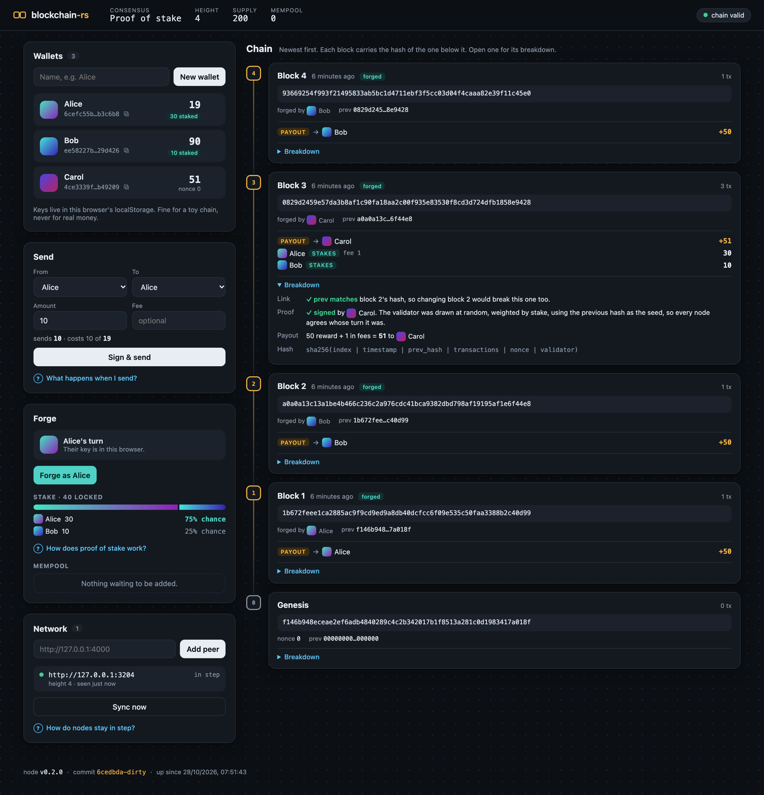
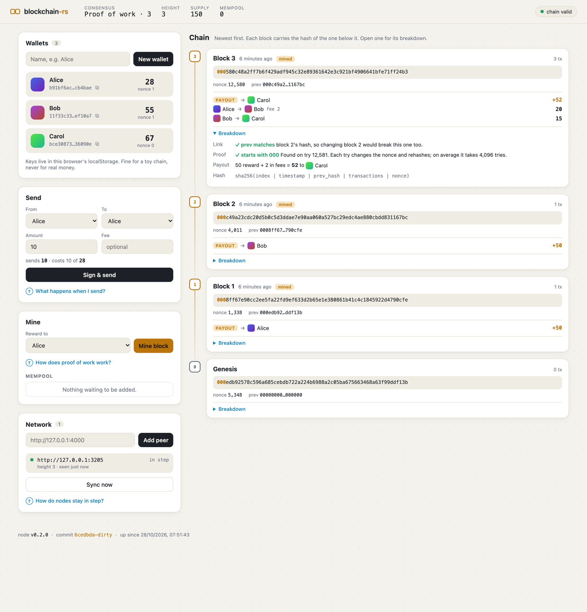
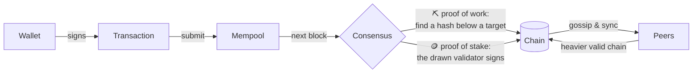
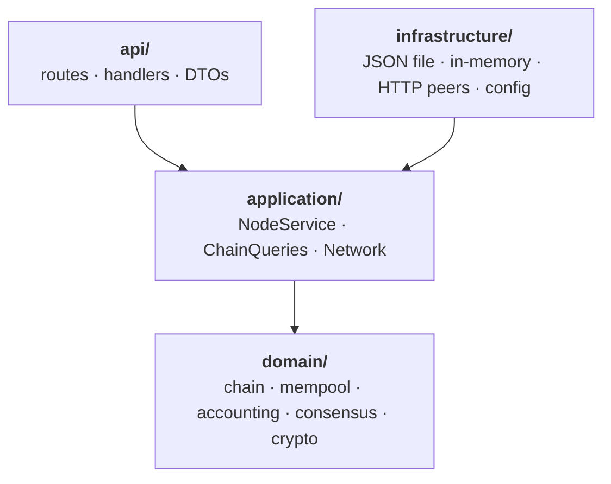

<div align="center">

# ⛓️ blockchain-rs

**A small, readable cryptocurrency in Rust that you can run, break and watch heal.**

Proof of work *or* proof of stake · keys that never leave your browser · fees · peers that gossip and sync · a web UI that explains every block

[](https://github.com/alex-quiterio/blockchain-rs/actions/workflows/test.yml)




</div>

---

## ✨ What's inside

| | |
| --- | --- |
| 🔐 **Wallets** | ed25519 keys made, used and encrypted in your browser. The node only sees signatures. |
| ⛏️ **Proof of work** | Find a hash below a target. The difficulty adjusts to keep blocks coming at a steady pace. |
| 🪙 **Proof of stake** | Stake coins; each block's validator is drawn by stake from a randomness beacon nobody can steer. |
| 💸 **Fees** | Blocks have a size limit, so the highest fees go in first. `GET /fees` says what fee gets in now. |
| 🌐 **Peers** | Nodes gossip new blocks and transactions, catch up headers first, meet the peers of their peers, forget those gone for good, and heal links after a restart. |
| 🏆 **Forks** | The heaviest valid chain wins (most work or most stake), never undoing more than `MAX_REORG_DEPTH` blocks. |
| 🌳 **Merkle proofs** | A light client can check a payment is in a block with a few hashes. |
| 🔍 **Validation** | Every rule is replayed, and a refusal names the block and the rule it broke. |

## 🚀 Quick start

```sh
docker compose up --build     # three linked nodes on :3000, :3001 and :3002
```

Or a single node without Docker:

```sh
npm ci && npm run build       # the web UI, into public/
cargo run                     # http://127.0.0.1:3000
```

Then open **http://127.0.0.1:3000**:

1. 🔒 **Choose a passphrase.** It encrypts your keys in the browser.
2. 👛 **Make two wallets** and **mine** a block to fund one.
3. 💸 **Send some coins.** The page signs; only the signature goes to the node.
4. 🔍 **Open a block's Breakdown** to see why it's valid. With Docker, open `:3001` and watch the block arrive.
5. 🧭 **Open the Explorer** (`/explorer.html`) to look up any block, transaction or address, with the node's checks redone in your browser.

For **proof of stake**, run `CONSENSUS=pos CHAIN_FILE=pos.json cargo run` (or put `CONSENSUS=pos` before `docker compose`). Anyone may forge until someone stakes: forge a few blocks, send some coins to **Stake**, and watch the turns begin.

### More to try

```sh
./scripts/story.sh                                    # a narrated tour of the Docker network
docker compose --profile load run --rm loadgen        # flood it with transactions and watch it cope
```

The **story** opens wallets, gossips transfers, fills a block, turns away cheaters, races two miners and checks a Merkle proof, timing each message as it reaches each node. The **load generator** sends random signed transactions with random fees, adds blocks on a schedule, and prints throughput, latency and whether the nodes agree. Its first run found a real bottleneck: every transaction re-checked the whole mempool.

In the Docker network, node C and node A only know node B, and gossip carries everything across. Each node keeps its chain in a volume; `docker compose down -v` wipes them.

<details>
<summary><b>📸 Proof of work, light mode</b></summary>
<br />

</details>

## ⚙️ Configuration

| Variable | Default | What it does |
| --- | --- | --- |
| `CONSENSUS` | `pow` | `pow` or `pos`. |
| `DIFFICULTY` | `4` | Starting difficulty, in leading hex zeros (16⁴ hashes a block). |
| `TARGET_BLOCK_SECS` | `10` | The pace the difficulty aims for. `0` keeps it fixed. |
| `RETARGET_BLOCKS` | `10` | Blocks between difficulty adjustments. |
| `REWARD` | `50` | Coins per block, before fees. |
| `MAX_BLOCK_TRANSFERS` | `100` | Transfers a block may hold. `0` means no limit. |
| `MAX_WAITING` | `5000` | Transfers that may wait for a block at once. When full, a new one must pay more than the cheapest it pushes out. |
| `BIND_ADDR` | `127.0.0.1:3000` | Where the node listens. |
| `CHAIN_FILE` | `chain.json` | Where the chain is saved. |
| `PEERS` | none | Comma-separated peer URLs to join on startup. |
| `PUBLIC_URL` | `http://$BIND_ADDR` | How peers should reach this node. |
| `SYNC_SECS` | `5` | How often to pull from peers. |
| `MAX_PEERS` | `16` | The most peers a node seeks out by discovery. Peers it's told to join, and peers that reach out to it, are always added. |
| `FORGET_SECS` | `600` | How long a peer may go unanswered before it's forgotten. Peers in `PEERS` are never forgotten. |
| `MAX_REORG_DEPTH` | `64` | The most of its own blocks a node will undo to switch forks. |
| `SNAPSHOT_BLOCKS` | `100` | Blocks between balance snapshots, so a restart needn't replay everything. `0` takes none. |

A saved chain only loads under the rules it was made with. Delete the file to start over.

## 🧠 How it works



Each block names the hash of the one before it, so changing an old block breaks every block after it. Its first transaction is the **payout**: the reward plus the block's fees, to whoever produced it.

- **Forks.** A node keeps the *heaviest* valid chain: most work under proof of work, most stake behind the blocks under proof of stake. Ties go to the lower tip hash, so every node picks the same one.
- **Fees.** When more is waiting than a block holds, the highest fees go first, each sender's transfers staying in nonce order. Only the size limit is a consensus rule; which transfers fill a block is the producer's choice. At most `MAX_WAITING` may wait at once; once full, a new transfer must outbid the cheapest last transfer of another sender, which leaves. Paying yourself costs nothing, so without that limit one coin could fill every node's memory.
- **Replays.** Every transfer names its chain, the hash of its genesis block, and the signature covers it. Networks with different rules have different genesis blocks, so a transfer signed on one is refused on another even where its nonce is still free. `GET /status` gives the id to sign with. Transfers in blocks from before 1 November 2026 may name none, so older chains still load.
- **Difficulty.** Every `RETARGET_BLOCKS` blocks, the work is scaled by how far the last ones were from the target pace, by at most 4×. As in Bitcoin, a block's time must be after the median of the last 11 and at most 2 hours ahead, so miners can't fake the pace.
- **Validator turns.** Like Ethereum's RANDAO, a validator commits to the end of a secret hash chain when they first stake, and each block they forge reveals the next link back. Reveals are fixed in advance and mixed into the beacon that picks the next validator, so no choice of timestamp or contents can steer the draw.
- **Catching up.** A node behind a peer fetches its headers first and checks them: hashes, links, times, and the work or the validator's signature. It fetches blocks only if they hold up, only from where the peer's chain leaves its own, and under proof of work only if they're heavier, so a peer that claims more than it has costs just its headers.
- **Storage.** One block of JSON per line, appended as the chain grows and rewritten atomically after a fork, with a snapshot of the balances every `SNAPSHOT_BLOCKS` blocks.

## 🏛️ Architecture

Domain-driven design, with dependencies pointing inward:



- **`domain/`** ([README](src/domain/README.md)) holds the rules and no I/O, grouped by concept rather than by building block. The chain and the mempool are the two aggregates, each under its own lock, so submitting a transaction never waits on mining. Amounts, addresses, hashes and signatures are value objects, and every refusal is a typed error that says what was refused.
- **`application/`** ([README](src/application/README.md)): `NodeService` applies every change to a copy of the chain, saves it, then swaps it in, so memory and disk never disagree; the copy shares the blocks, so it stays cheap. `ChainQueries` answers questions without changing anything. `Network` gossips and syncs with peers. Work that replays the chain or writes to disk runs off the async runtime.
- **`infrastructure/`** ([README](src/infrastructure/README.md)) has the adapters: the JSON file and in-memory stores, the HTTP peer client, logging and configuration. `main.rs` only wires them together.
- **`api/`**: the HTTP routes, handlers and request and response bodies.
- **`web/`**: the web UI, in TypeScript, laid out the same way. See [web/README.md](web/README.md).
- **`src/bin/loadgen.rs`**: the load generator, a separate client that only talks HTTP.

Each file's doc comment says what it holds and which building block it is.

## 📡 API

| Method | Path | What it does |
| --- | --- | --- |
| GET | `/status` | `{chain, height, tip, weight, pending}`, cheap enough to poll. `chain` is what every transfer must name. |
| GET | `/chain` | The blocks, `?from=N&limit=M` for a range. |
| POST | `/chain` | Offer blocks; adopted if they make a valid, heavier chain. |
| GET | `/chain/valid` | A full replay: `{valid, problem, length, weight}`. |
| GET | `/chain/work` | Proof of work: the work each block required. |
| GET | `/headers` | Blocks without their transactions, `?from=N&limit=M` for a range: what light clients keep and peers check first. |
| GET | `/blocks/:id` | A block, by height or hash. |
| POST | `/blocks` | Proof of stake: submit a proposal signed by its validator. |
| GET | `/balances/:address` | Balance, stake, next nonce, and what a stake or forge needs next. |
| POST | `/transactions` | Submit a signed transaction; it's gossiped to peers. |
| GET | `/transactions/pending` | The mempool. |
| GET | `/transactions/:signature` | Where a transaction is: pending, or its block and confirmations. |
| GET | `/transactions/:signature/proof` | A Merkle proof that a confirmed transaction is in its block. |
| GET | `/addresses/:address/transactions` | An address's history, pending first. |
| GET | `/fees` | The fee sure to get in the next block, and what recent blocks took. |
| GET | `/consensus` | The rules, the next block's work, stakes, the beacon and whose turn it is. |
| POST | `/mine` | Proof of work: `{miner}`. |
| POST | `/forge/proposal` | Proof of stake: the unsigned block a validator should sign next. |
| GET · POST | `/peers` | List peers, or add one with `{url}`. |
| POST | `/sync` | Pull from every peer now. |
| GET | `/node` | The running node's version and commit. |

`POST /wallets`, `/transactions/sign` and `/forge` take secret keys over HTTP, as shortcuts for `curl` experiments. The web UI never uses them; don't use them for anything real.

## 🧪 Tests

```sh
cargo test        # unit, HTTP, property-based and doctests
npm test          # the web UI's domain and use cases
npm run check     # TypeScript, against API types generated from the Rust code
npm run e2e       # both pages in headless Chrome (needs Chrome, a release build and npm run build)
```

The property tests (`tests/properties.rs`) run hundreds of random scenarios: coins are never created or destroyed, transactions in any order end in the same balances, forks in any order settle on the same chain, nothing about a block can steer who forges next, and tampered forks are refused at the altered block. Run more with `PROPTEST_CASES=1000 cargo test --release --test properties`.

CI runs all of it, plus `cargo fmt`, `clippy -D warnings` and Prettier, on every push and pull request.

## 💡 Ideas

Nothing here is built yet:

- **Consensus:** slashing for double-signing, finality checkpoints, skipping absent validators.
- **Wallets:** HD wallets from a seed phrase, multisig addresses.
- **Network:** banning peers that keep sending invalid chains.
- **Load generator:** partition a node mid-run, or add miners part way, and watch forks and retargeting react.
