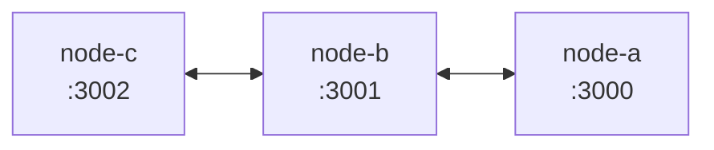
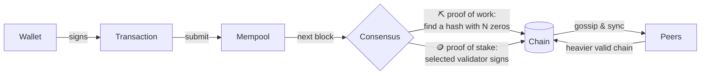
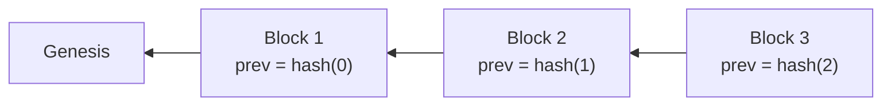
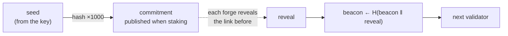
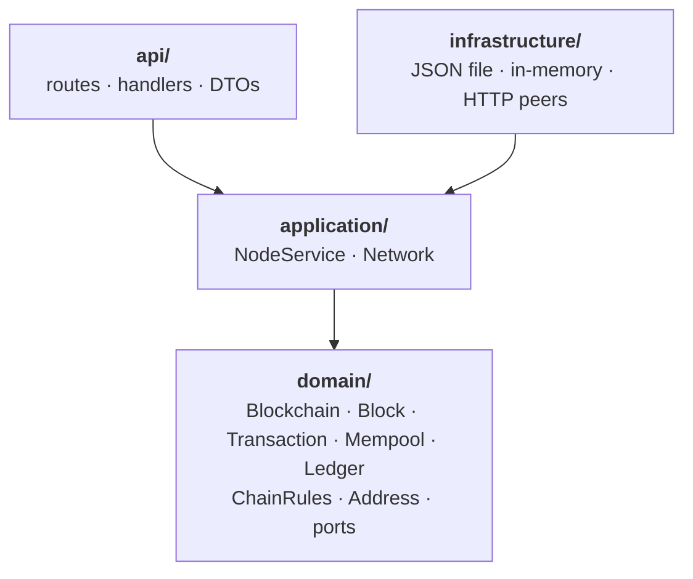

<div align="center">

# ⛓️ blockchain-rs

**A small, readable cryptocurrency in Rust that you can run, break and watch heal.**

Proof of work *or* proof of stake · keys that never leave your browser · fees · peers that gossip and sync · a web UI that explains every block

[](https://github.com/alex-quiterio/blockchain-rs/actions/workflows/test.yml)


</div>

---

## ✨ What's inside

| | |
| --- | --- |
| 🔐 **Wallets** | ed25519 keypairs made and used in your browser. Keys never leave the page, and they're saved encrypted with your passphrase. |
| ✍️ **Transactions** | Signed over `from \| to \| amount \| nonce` (plus the fee, when there is one). The nonce stops replays. |
| ⛏️ **Proof of work** | Mine a block by finding a hash with `DIFFICULTY` leading zeros. |
| 🪙 **Proof of stake** | Lock coins with a transaction to `stake`. Each block's validator is drawn at random, weighted by stake, from a commit-reveal randomness beacon that forgers can't steer, then signs the block. |
| 💸 **Fees** | Optional per transaction. Whoever adds the block gets the reward plus every fee in it. |
| 🌐 **Peers & sync** | Nodes introduce themselves both ways, gossip new blocks and transactions, and pull from each other every few seconds. |
| 🏆 **Heaviest chain wins** | Forks are settled by total work (proof of work) or total stake behind the blocks (proof of stake), not length. Ties go to the lower tip hash so every node agrees, and no fork may undo more than `MAX_REORG_DEPTH` blocks. Transfers that dropped out go back to the mempool. |
| 💾 **Storage** | The chain is saved to JSON with atomic writes and fully replayed on startup, so a tampered file is refused. |
| 🔍 **Validation** | Replays everything: links, hashes, work or signatures, rewards, fees, nonces, balances and stakes. |

## 🚀 Quick start

```sh
docker compose up --build     # three linked nodes on :3000, :3001 and :3002
# or, for a single node:
cargo run                     # http://127.0.0.1:3000
```

Open **http://127.0.0.1:3000** and:

1. 🔒 **Choose a passphrase.** It encrypts your wallets' keys before they're saved in the browser.
2. 👛 **Make a couple of wallets**, then **mine** a block to fund one.
3. 💸 **Send some coins**, with a fee if you like. The page signs the transaction itself and only the signature goes to the node.
4. 🔍 **Open any block's Breakdown** to see why it's valid. With Docker running, open `:3001` too and watch the block arrive.

### Proof of stake

```sh
CONSENSUS=pos CHAIN_FILE=pos.json cargo run
```

While nothing is staked, anyone may forge. Forge a few blocks to earn coins, send some to **Stake** from the Send panel, and watch the Forge panel switch to whoever's turn it is.

### 🐳 A three-node network, one command

```sh
docker compose up --build
```



That starts nodes on **:3000**, **:3001** and **:3002**. C and A only know B, and gossip carries everything across. Mine on one node and the block reaches the others within seconds. Add `CONSENSUS=pos` in front for proof of stake, and `GIT_COMMIT=$(git rev-parse --short HEAD)` to show the real commit in the footer. Each node keeps its chain in its own volume, and `docker compose down -v` wipes them.

<details>
<summary><b>Without Docker</b></summary>

```sh
cargo build
BIND_ADDR=127.0.0.1:3000 CHAIN_FILE=a.json ./target/debug/blockchain &
BIND_ADDR=127.0.0.1:3001 CHAIN_FILE=b.json PEERS=http://127.0.0.1:3000 ./target/debug/blockchain &
BIND_ADDR=127.0.0.1:3002 CHAIN_FILE=c.json PEERS=http://127.0.0.1:3001 ./target/debug/blockchain &
```

</details>

Each node's UI shows its peers and whether they're ahead, behind or in step.

<details>
<summary><b>📸 Proof of work, light mode</b></summary>
<br />

</details>

## ⚙️ Configuration

| Variable | Default | What it does |
| --- | --- | --- |
| `CONSENSUS` | `pow` | `pow` or `pos`. |
| `DIFFICULTY` | `4` | Leading hex zeros a proof-of-work hash needs. |
| `REWARD` | `50` | Coins paid for each block, before fees. |
| `BIND_ADDR` | `127.0.0.1:3000` | Where the node listens. |
| `CHAIN_FILE` | `chain.json` | Where the chain is saved. |
| `PEERS` | none | Comma-separated peer URLs to join on startup. |
| `PUBLIC_URL` | `http://$BIND_ADDR` | How peers should reach this node. |
| `SYNC_SECS` | `5` | How often to pull from peers. |
| `MAX_REORG_DEPTH` | `64` | The most of its own blocks a node will undo to switch forks. |

A saved chain only loads under the rules it was made with. Delete the file to start over.

## 🧠 How it works



Every block stores the hash of the one before it, so changing an old block breaks every block after it:



When forks compete, a node keeps the **heaviest** valid chain, not the longest:

| Consensus | One block weighs | Why |
| --- | --- | --- |
| ⛏️ Proof of work | 16^difficulty | The hashes it takes on average to find, so the fork with the most work wins. |
| 🪙 Proof of stake | its validator's stake (at least 1) | A short fork forged by real stakers outweighs a long one nobody staked on. |

Exact ties go to the lower tip hash, so two nodes on equal forks always pick the same one. And no fork may undo more than `MAX_REORG_DEPTH` blocks, however heavy it is, so old history can't be rewritten.

The first transaction in each block is the **payout**: the reward plus the block's fees, to whoever mined or forged it. Validation checks that sum.

### 🎲 Validator turns nobody can steer

Under proof of stake, the next validator is drawn from a **randomness beacon**, not from the previous block's hash. Seeding the draw from the hash would hand the forger a lever: they could try timestamp after timestamp until the draw picked them again. The beacon works like Ethereum's RANDAO:

1. **Commit.** A validator's first stake publishes the end of a secret hash chain, `H¹⁰⁰⁰(seed)`. The seed is derived from their key, so their wallet can recompute any link and nobody else can.
2. **Reveal.** Every block they forge must reveal the next link back: a value whose hash is the last one shown. Anyone can check it with one hash, and it was fixed the moment they committed.
3. **Mix.** The reveal is mixed into the beacon, `R ← H(R ‖ reveal)`, and the beacon picks the next validator.



A forger's block can differ in timestamp and contents, but its reveal can't, so none of those differences change who's next. While nothing is staked, anyone may forge and the beacon doesn't move at all. Unstaking everything ends a commitment, and a validator who uses up all 1,000 reveals sits out until they stake again with a new one.

## 🏛️ Architecture

The code follows domain-driven design. Dependencies only point inward:



- **`domain/`** has the rules and no I/O.
  - `chain.rs`: the `Blockchain` aggregate root, which mines, forges, validates and runs `adopt_if_heavier`
  - `block.rs`: `Block`, which mines, forges and hashes itself, and `Transaction`, which signs itself
  - `rules.rs`: `ChainRules`, `Consensus` and the stake-weighted `select_validator`
  - `randao.rs`: the commit-reveal hash chains and the beacon that pick validators
  - `weight.rs`: `ChainWeight`, what a fork is worth: 16^difficulty per mined block, or the validator's stake per forged block
  - `mempool.rs`, `ledger.rs`: pending transactions, and the balances, stakes and nonces
  - `address.rs`: a value object that can only hold a valid public key
  - `error.rs`, `crypto.rs`, `repository.rs`: domain errors, signing and hashing, and the storage port
- **`application/`**
  - `NodeService` runs each use case on a copy of the chain and only swaps it in once it's saved.
  - `Network` keeps the peers in step through the `PeerClient` port.
- **`infrastructure/`** has the adapters: `JsonFileRepository`, `InMemoryRepository` and `HttpPeerClient`.
- **`api/`** is the HTTP interface. **`public/`** is the web UI, plain HTML, CSS and JS with no build step.

## 📡 API

| Method | Path | What it does |
| --- | --- | --- |
| POST | `/wallets` | Make a keypair: `{address, secret_key}`. |
| GET | `/balances/:address` | `{balance, staked, next_nonce, next_epoch, reveals_left, commitment_due}`. The last three tell a wallet which commitment or reveal to send. |
| POST | `/transactions/sign` | `{secret_key, to, amount, fee?, nonce?, commitment?}` → a signed transaction. `to` may be `stake` or `unstake`. A first stake's commitment is worked out from the key if left out. |
| POST | `/transactions` | Submit a signed transaction. It's gossiped to peers. |
| GET | `/transactions/pending` | The mempool. |
| POST | `/mine` | Proof of work: `{miner}`. |
| POST | `/forge/proposal` | Proof of stake: `{validator, reveal?}` → the unsigned block that validator should sign next. The reveal is required once validators are being drawn. |
| POST | `/blocks` | Proof of stake: submit a proposal signed by its validator. |
| POST | `/forge` | Proof of stake shortcut for scripts: `{secret_key}` of the selected validator. |
| GET | `/consensus` | Rules, stakes, the randomness beacon and whose turn it is next. |
| GET | `/chain` | Every block. |
| POST | `/chain` | Offer a chain: adopted if valid and heavier. `409` if it would undo too many blocks. |
| GET | `/chain/valid` | `{valid, length, weight}` after a full replay. |
| GET · POST | `/peers` | List peers, or add one with `{url}`. |
| POST | `/sync` | Pull from every peer now. |
| GET | `/node` | Version and git commit of the running node. |

> 🔐 **How the UI protects keys.**
> - **On disk:** secret keys are encrypted with your passphrase (PBKDF2-SHA256, 600,000 rounds, then AES-256-GCM) before they're saved, so browser storage only ever holds scrambled data.
> - **In use:** unlocking decrypts them into the tab's memory, and Lock, closing the tab or 15 idle minutes wipes them.
> - **Backup:** **Back up** exports the encrypted vault and **Restore** imports one; there's no passphrase reset.
> - **Limits:** this runs only on `localhost`, `127.0.0.1` or HTTPS, where browsers allow WebCrypto. A malicious extension running while you're unlocked could still read the page's memory.
>
> The web UI never sends a secret key. It generates keys and signs transactions in the page, and forges by asking for a proposal, signing its hash and sending back the signed block. `/wallets`, `/transactions/sign` and `/forge` still take keys over HTTP as shortcuts for `curl` experiments; don't use them for anything real.

## 🧪 Tests

```sh
cargo test        # 72 tests: unit, HTTP and property-based
```

- **Domain:** consensus rules, staking, fees, forks and tampering.
- **Application:** a whole peer network simulated in one process.
- **HTTP:** round trips through the API, including forging with a key that never leaves the client.
- **Properties** (`tests/properties.rs`, [proptest](https://proptest-rs.github.io/proptest/)): hundreds of random scenarios per run.
  - Random transfers, stakes and blocks never create or destroy coins, and never break nonces or replay.
  - Transactions arriving in any order end in the same balances.
  - Forks offered in any order settle on the same chain.
  - No version of a block, whatever its timestamp, contents or fees, changes who forges next.
  - Tampered forks are never adopted.

  Failing cases shrink to a minimal example and are saved to `tests/properties.proptest-regressions`. Run more with `PROPTEST_CASES=1000 cargo test --release --test properties`.

CI runs `fmt`, `clippy -D warnings` and the tests on every push and pull request.

## 💡 Ideas

Nothing here is built yet. Each would make a good next step.

**⚖️ Consensus**
- **Difficulty that adjusts** to keep blocks coming at a steady pace as miners join or leave. Chain weight already counts work per block, so it's ready for this.
- **Slashing**: burn the stake of a validator caught signing two blocks at the same height.
- **Finality checkpoints**: stakers vote to make a block permanent, instead of relying only on the reorg limit.
- **Skipping absent validators**: a selected validator who never forges stalls the chain. Time slots that pass the turn on after a timeout would fix it, and withholding a reveal would then cost a block reward.

**💸 Fees and blocks**
- **Block size limits**, so fees decide what gets in first.
- **Fee estimates**: suggest a fee from what recent blocks accepted.

**🔐 Wallets and privacy**
- **HD wallets**: many addresses from one seed phrase.
- **Multisig addresses** that need M of N signatures to spend.

**🌳 Light clients**
- **Merkle roots** in block headers, so a transaction can be proven to be in a block without downloading the whole block.
- **Headers-first sync**: fetch and check headers before full blocks.

**🌐 Network**
- **Peer discovery**: learn new peers from existing ones.
- **Ban misbehaving peers** that keep offering invalid chains.
- **Incremental sync**: send only the blocks a peer is missing, instead of the whole chain.

**🛠️ Developer experience**
- **A block explorer page**: search by address, transaction or hash.
- **A load generator** that floods a network with random transactions to watch fees and sync under pressure.
