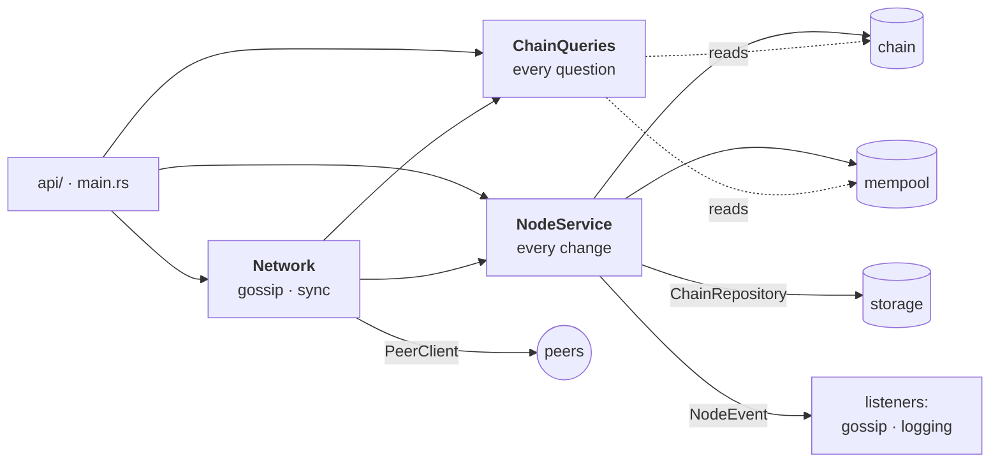

# ⚙️ The application

The node's use cases: changing the chain and saving it, answering questions about it, and keeping it in step with other nodes. The rules come from the [domain](../domain/README.md); this layer decides when they run, keeps memory and storage in agreement, and tells whoever's listening what happened. It reaches storage and peers only through ports, which infrastructure implements.

There are three services, one per job, and they share the chain and the mempool, each behind its own lock.

## `NodeService`: every change (`node/`)

| | |
| --- | --- |
| `mod.rs` | Opening a node, and `commit`, the one path every change to the chain takes. |
| `blocks.rs` | Mining (`mine`, `mine_unless`), forging (`forge`, `append_forged`), and taking another node's blocks (`extend`, `adopt_if_heavier`). |
| `transactions.rs` | `submit` and `submit_from`: a transaction into the mempool, from a client or from a peer. |
| `snapshots.rs` | Saving a snapshot of the balances every `SNAPSHOT_BLOCKS` blocks, so a restart replays only the blocks since. |
| `events.rs` | `NodeEvent`, either a `ChainEvent` or a `MempoolEvent` (with the peer it came from), and `subscribe`. |
| `error.rs` | `NodeError`: a domain rule refused the change (`ApplicationError`), or storage failed. |

**How a change is committed.** `commit` locks the chain, applies the change to a copy, and saves the blocks the change's events say are new. Only then does it swap the copy in, so memory never holds what disk doesn't. It rebases the mempool onto the new chain, taking back the transfers a fork dropped. Once the locks are released, it tells the listeners what happened, so a listener may call back in. The copy is cheap: blocks are shared behind `Arc`s.

**Opening.** `NodeService::opening(repository, rules, reorg_limit)` gathers listeners before `open()`, so they hear that a new chain was started. A saved chain is restored, from its snapshot when one fits, and replayed in full otherwise.

**Mining** searches for a nonce without holding the chain lock. It stops with `StaleBlock` if a peer's block takes the tip first, or if `mine_unless` is cancelled because the caller hung up.

## `ChainQueries`: every question (`queries/`)

Reads only. It answers from the same chain and mempool the node changes, and copies out what it returns.

| | |
| --- | --- |
| `chain.rs` | Blocks and headers in ranges, a block by height or hash, the tip, the work each block needed, a full replay (`status`), and `weigh_headers` for a peer's headers. |
| `transactions.rs` | Where a transfer is (`locate`), an address's `history`, a Merkle proof (`prove`), and what's `pending`. |
| `accounts.rs` | What an address holds and stakes, and what its next transaction needs (`next_nonce`). |
| `fees.rs` | The fee sure to get into the next block, and what recent blocks took. |
| `consensus.rs` | The rules, whose turn it is, and the block a validator should sign (`propose`). |

Questions only a reader asks, like an address's history, are worked out here from the blocks, so the aggregates keep only what their rules need. Anything that replays the whole chain runs on a copy, so the chain isn't locked while it's checked.

## `Network`: keeping in step with peers (`network/`)

| | |
| --- | --- |
| `mod.rs` | `Network` and its peers: `add_peer` introduces this node back, so links go both ways and heal after a restart. |
| `client.rs` | `PeerClient`: the **port** to other nodes (status, headers, blocks, pending, offers, introductions). |
| `gossip.rs` | Pushing: `broadcast_tip` sends a new block to every peer at once, plus recent blocks to a peer that lacks the parent. `gossip_accepted` passes on every transaction the mempool accepts, except back to the peer it came from. |
| `sync.rs` | Pulling: `sync` checks in with every peer at once, and `keep_in_sync` does it every few seconds. |

**Catching up is headers first.** When a peer claims a heavier chain, the node fetches its headers (`HEADER_PAGE` at a time) and has the domain check and weigh them. It fetches blocks only if they hold up, only from where the peer's chain leaves ours. Blocks on top of our tip are offered a page at a time (`SYNC_PAGE`). A fork is fetched whole first, since one page of it can weigh less than what it replaces.

## Running off the async runtime

Changing or replaying the chain hashes, checks signatures and writes to disk. `off_runtime` (in `mod.rs`) runs that on a thread set aside for blocking work. The API and `Network` call every such use case through it, so a long replay never stalls other requests. The services themselves are plain synchronous code.

## Locks

- The chain and the mempool are locked separately, so submitting a transaction never waits for mining or a peer's blocks.
- When both are needed, the chain is locked first.
- Listeners are told after both are released.

## Tests

| | |
| --- | --- |
| `node/tests.rs` | Opening, saving and restarting (from a snapshot too), a tampered store refusing to start, a failed save leaving the chain unchanged, mining giving up when a peer takes the tip or when cancelled, forks giving the mempool back what they dropped, proofs and histories, and listeners hearing only what was saved. |
| `network/tests.rs` | A whole network in one process: a `Mesh` implements `PeerClient` by calling other nodes directly and logs every message. So tests can assert exactly what went over the wire, such as headers first, then only the blocks a node lacks. |
