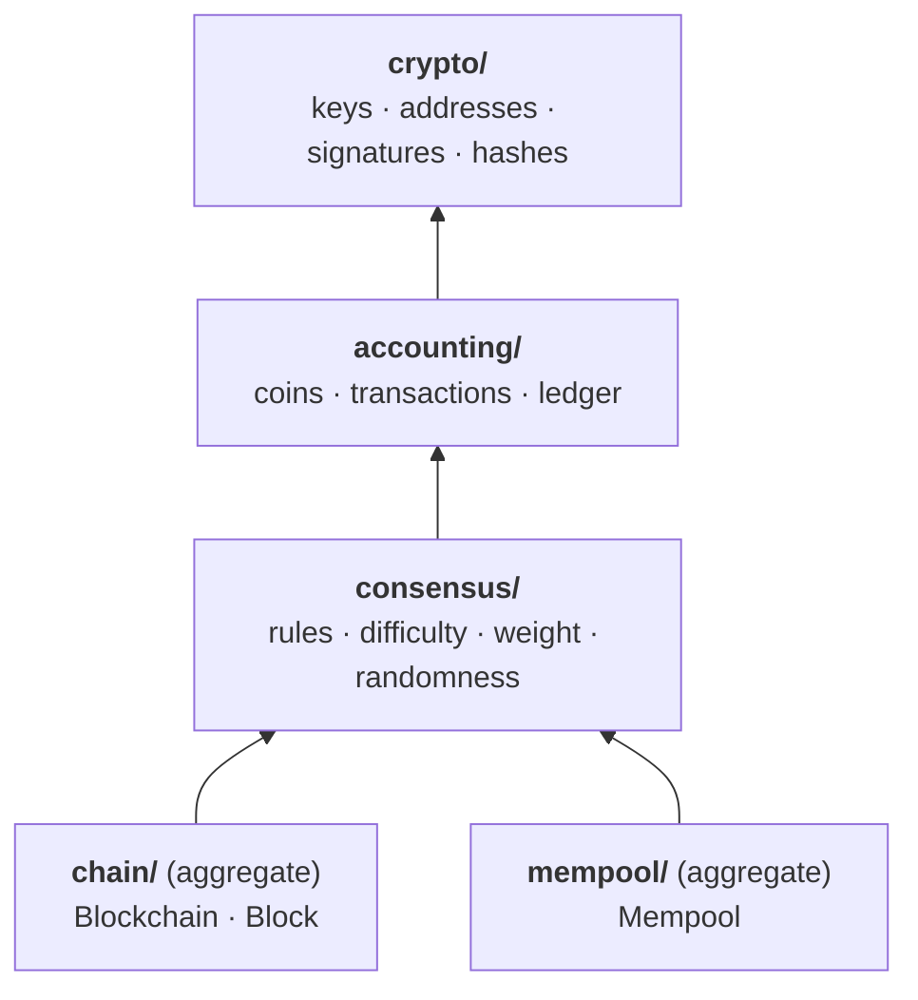

# 🧩 The domain

The rules of the chain, and nothing else: no files, no network, no clock beyond reading the time. Everything the node does to its chain is decided here; the layers above only store it, serve it and pass it around.

## Concepts, not building blocks

Folders are concepts from the problem, as Evans recommends, never kinds of code. There's no `aggregates/`, `values/`, `services/` or `errors/`: each concept keeps its own value objects, services and errors, and each file's doc comment says which building blocks it holds.

Concepts depend one way, from the foundation up:

The two aggregates never depend on each other. A node asks the mempool for candidates and hands them to the chain, and tells the mempool what the chain did.

## `crypto/`: what everything is built on

| | |
| --- | --- |
| `mod.rs` | **Domain service**: making ed25519 keys, signing and checking, and SHA-256. |
| `address.rs` | `Address` (**value object**): an account, which is a public key. One that exists has been checked. |
| `signature.rs` | `Signature` (**value object**): 128 hex characters. A block reward has none, which travels as `""`. |
| `hash.rs` | `sha256_type!`, which each concept uses to declare its own kind of hash, so a block hash can never be passed as a Merkle root. |
| `error.rs` | `ValueError`: a string that isn't a valid address, signature or hash. |

## `accounting/`: who owns what

Both aggregates use these, so they live outside both.

| | |
| --- | --- |
| `chain_id.rs` | `ChainId` (**value object**): the genesis hash a transfer names, so it can't be replayed on another network, and when that became required. |
| `coins.rs` | `Coins` (**value object**): every amount, fee, stake and reward. Sums are checked and never wrap around. |
| `party.rs` | `Source` (an account, or the coinbase for new coins) and `Destination` (an account, `stake` or `unstake`): **value objects** instead of magic strings. |
| `transaction.rs` | `Transaction` (**value object**): signed once, then never changed. `TxKind` says what it does. |
| `ledger.rs` | `Ledger` (**value object** holding an aggregate's state): balances, stakes, nonces and validators, the chain they're of, and the rules a transaction must pass before it's applied, its `ChainId` among them. |
| `error.rs` | `TransactionError`: why a transaction is refused, such as `BadNonce`, `InsufficientFunds` or `AlreadyPending`. |

## `consensus/`: how nodes agree on one chain

| | |
| --- | --- |
| `rules.rs` | `ChainRules`, `Consensus` and `Retarget` (**value objects**): what every node on a network must share. `select_validator` (**domain service**) draws the next validator from the stakes. |
| `capacity.rs` | `BlockCapacity` (**value object**): how many transfers a block may hold. |
| `weight.rs` | `ChainWeight` (**value object**): what a fork is worth, as total work or total stake. |
| `difficulty.rs` | **Domain service**: work targets, retargeting, and the timestamp rules. It reads any `Timeline`, so it runs over a chain's blocks, or our blocks followed by a peer's headers. |
| `randao.rs` | **Domain service**: commit-reveal hash chains, after Ethereum's RANDAO. |
| `beacon.rs` | `Commitment`, `Reveal` and `Beacon` (**value objects**): the values commit-reveal works with. |
| `validators.rs` | `Validators` (**value object**, carried in the ledger): each validator's reveal chain, and the beacon. |

## `chain/`: the chain aggregate

`Blockchain` is the root. Every change goes through it, and it checks every block before it becomes part of the chain.

| | |
| --- | --- |
| `mod.rs` | `Blockchain`: mining, forging, proposing, `extend` (blocks from some height on) and `adopt_if_heavier` (the fork-choice rule). |
| `validation.rs` | The rules a block is checked by, and replaying a chain by them. |
| `headers.rs` | `weigh_headers`: checking a peer's headers before fetching its blocks, and `HeaderVerdict`, whether and from where to fetch them. |
| `tally.rs` | What the blocks add up to (a ledger, a weight and the current work), kept for each recent block so forks are checked from where they split, plus the occasional `Snapshot`. |
| `events.rs` | `ChainEvent`: `Started`, `Extended` or `Reorganized`, recorded as the chain changes, for whoever changed it to save, log and pass on. |
| `reorg.rs` | `ReorgLimit`: how far back this node will follow a fork. Each node's own choice, not a consensus rule. |
| `repository.rs` | `ChainRepository`: the **port** the aggregate is stored through, which infrastructure implements. |
| `error.rs` | `ChainError`: why blocks can't become our chain (`InvalidBlock` names the height and the rule, `ReorgTooDeep` the depth). |
| `block/` | `Block`, the chain's **entity**: its header and hash (`header.rs`, `hash.rs`), how it's sealed (`sealing.rs`), its Merkle tree and proofs (`merkle.rs`, `proof.rs`), and `BlockError`, the rule a block breaks. Only the domain can change a block; outside it, blocks are read-only. |

The chain keeps its blocks behind `Arc`s, since a block never changes once it's in. Copying the chain, which a node does for every change, costs a pointer per block rather than the blocks.

## `mempool/`: the mempool aggregate

`Mempool` holds the transactions waiting for a block, and a ledger projected from them, so each new one is checked once against everything waiting.

| | |
| --- | --- |
| `mod.rs` | `Mempool`: `admit` a transaction (at most `MAX_WAITING`; once full, only by outbidding the cheapest one it can push out), offer `candidates` for a block, `rebase` onto the chain after it changes (taking back what a fork dropped), and `MempoolEvent` (`Accepted`, `Rebased`). |
| `selection.rs` | What it offers when more is waiting than fits: the highest fees first, each sender's transfers in nonce order. A producer's choice, not a consensus rule. |

## The invariants

- **A block is checked before it's in.** No method adds a block without applying every rule in `validation.rs`, and a refusal leaves the chain as it was.
- **Nothing signs for someone else.** A transaction is only valid with its sender's signature over exactly what it says, and a proof-of-stake block only with the drawn validator's.
- **Coins are never created or destroyed** except by the block reward, and sums never wrap around.
- **Every node picks the same fork.** The heaviest valid chain wins and ties go to the lower tip hash, but no fork may undo more than the `ReorgLimit`.
- **Nobody can steer who forges next.** Reveals are fixed when a validator commits, so nothing in a block changes the draw.

`tests/properties.rs` checks most of them over hundreds of random scenarios per run: the ledger never breaks, forks settle the same whatever order they arrive in, tampered forks are refused, and no version of a block changes who forges next.

## Adding to it

- **Put it in the concept that owns it.** Which transfers a block holds is the mempool's choice, while the chain only enforces the limit. If two concepts both need something, it belongs below both, as transactions do in `accounting/`.
- **Make primitives into value objects** that are checked when they're made, as `Coins`, `Address` and the hash types are, rather than passing `u64`s and `String`s around.
- **Make refusals typed and specific.** Add a variant to the concept's own error that says what was refused, not a string.
- **Keep I/O out.** A new store or client is a port declared here and an adapter in `infrastructure/`.
- **Name the building block** in the file's doc comment.

Tests live beside the code: `chain/tests.rs` for the aggregate and its block, and a `tests` module in the files with logic of their own.
