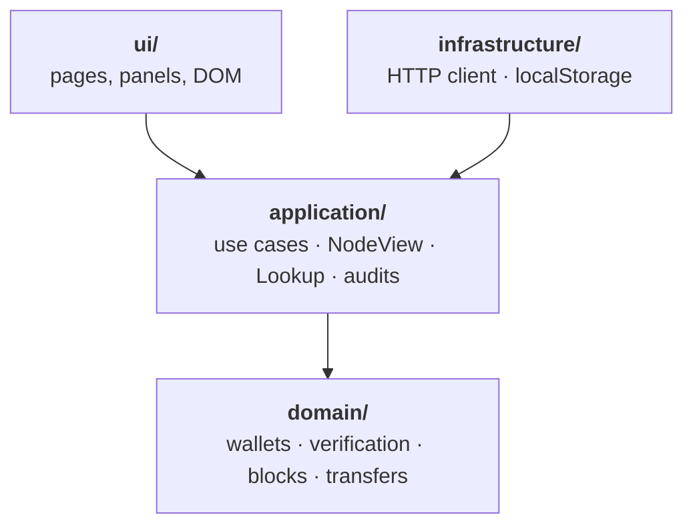

# 🖥️ The web UI

Two pages the node serves, written in TypeScript with no framework and no bundler:

- **The wallet** (`/`): make wallets, send coins, mine or forge, see your peers, and read why each block is valid.
- **The explorer** (`/explorer.html`): any block, transaction or address, with every one of the node's checks redone in your browser.

Keys never leave the page. It makes them, signs with them and keeps them encrypted with your passphrase; the node only ever sees signatures.

## Build and check

```sh
npm ci
npm run build     # web/src → public/, which the node serves (never committed)
npm test          # unit tests of the domain and use cases, run by Node as they are
npm run check     # type-checks everything against API types generated from the Rust code
npm run e2e       # both pages in headless Chrome; needs Chrome, `cargo build --release` and a build
npm run format    # Prettier
```

`npm run build` compiles `src/` into `public/js`, joins each page's stylesheets into one file (`public/css/node.css`, `public/css/explorer.css`), and copies each page's HTML to where it's served (`ui/node/index.html` → `/index.html`, `ui/explorer/index.html` → `/explorer.html`).

## Layout

The same layers as the node, pointing inward, each imported by name (`@domain`, `@application`, `@infra`, `@ui`) instead of climbing `../../..`:



| Folder | What's there |
| --- | --- |
| `src/domain/` | No DOM, no network. `wallets/`: the `Wallets` aggregate (nothing signs while it's locked), keys, the encrypted vault and reveal chains. `verification/`: re-checking what the node sends (Merkle proofs, header hashes, work, signatures), so the page needn't trust it. `blocks.ts`, `transfers.ts`: what a block and a transfer are. |
| `src/application/` | Use cases (sending, producing a block, making a wallet, peers), each a function given the `NodePort` and `Wallets` it uses. `NodeView`: the wallet page's read model of the node, which tells subscribers when it changes. `Lookup`: the explorer's reads. `audit.ts`: every check the pages show, decided here. `ports.ts`: `NodePort` and what its answers hold. |
| `src/infrastructure/` | `node_client.ts`, the HTTP adapter for `NodePort`, and `wallets_local_storage.ts`, the browser store for the wallets. |
| `src/ui/` | `dom.ts` and `base.css`, shared by both pages, then one folder per page. |
| `test/` | Unit tests, mirroring `src/`. Verification is tested against blocks and proofs recorded from real nodes (`scripts/record_fixtures.ts`). |
| `e2e/` | Drives both pages against fresh nodes, under both consensus modes. |
| `scripts/` | Finishing the build, resolving the layer aliases for Node, and recording fixtures. |

Nothing keeps module-level state or looks an adapter up. Each page's `main.ts` is where things are made: the HTTP client, the wallets, the view of the node, and the use cases given them.

### A page

```text
ui/node/
  index.html  main.ts  main.css     the page, put together, and its layout
  page.ts                           NodePage: what every panel is given
  actions.ts                        running a button's action, one at a time
  parties.ts  transfers.ts  work.ts what several panels draw
  panels/<name>/panel.ts  panel.css one folder per panel
```

Each panel installs itself with the `NodePage` and subscribes to the `NodeView`, redrawing only its own part when the view changes. Panels get the use cases, never the node's port, so none can go around one. A form is rebuilt only when what it offers changes (`rebuildOn`), so what's typed or chosen in it survives a redraw. The explorer is built the same way, with `pages/<name>/page.ts` given the `Lookup`.

### Styles

Each part's stylesheet nests its rules under `:where([data-part~="…"])`, and a page's shared ones under `:where([data-page="…"])`, matching attributes in the HTML, so no rule reaches outside its part. `:where()` adds no specificity. Only `base.css` is global.

## Staying in step with the node

`npm run check` first runs `cargo test` to write `src/infrastructure/node_wire.ts`, the API's bodies as the Rust code declares them. `node_wire_check.ts` then asserts, at compile time, that every answer `NodePort` declares is exactly the node's, and that every request the client sends is one the node accepts. Change a body in Rust and the check fails until the UI follows. Both files are left out of the build, which needs no Rust, and `node_wire.ts` is never committed.

## How keys are protected

- **Stored** encrypted with your passphrase: PBKDF2-SHA256, 600,000 rounds, then AES-256-GCM.
- **Unlocked** into the tab's memory only. Lock, closing the tab or 15 idle minutes wipes them.
- **Backed up** as the encrypted vault. There's no passphrase reset.
- **Limits:** WebCrypto only runs on `localhost`, `127.0.0.1` or HTTPS, and a malicious extension running while you're unlocked could read the page's memory.
